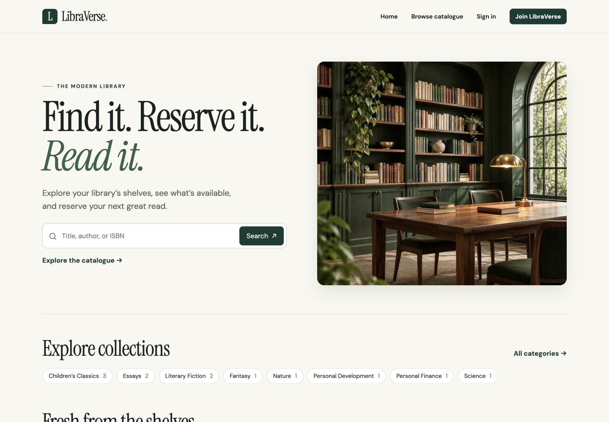
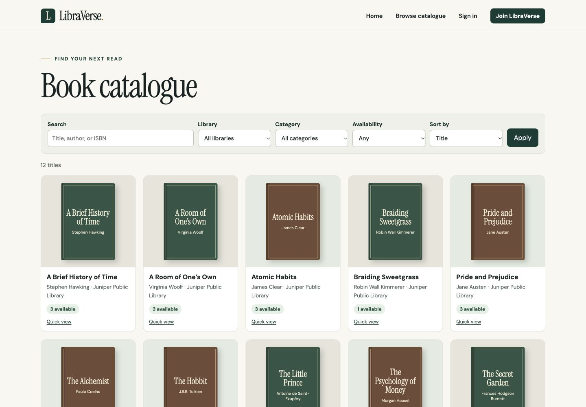
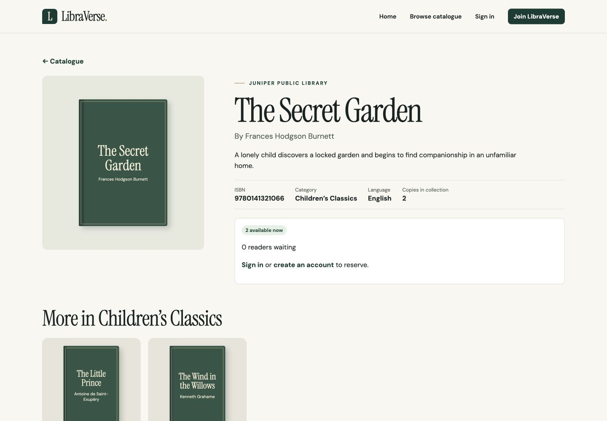
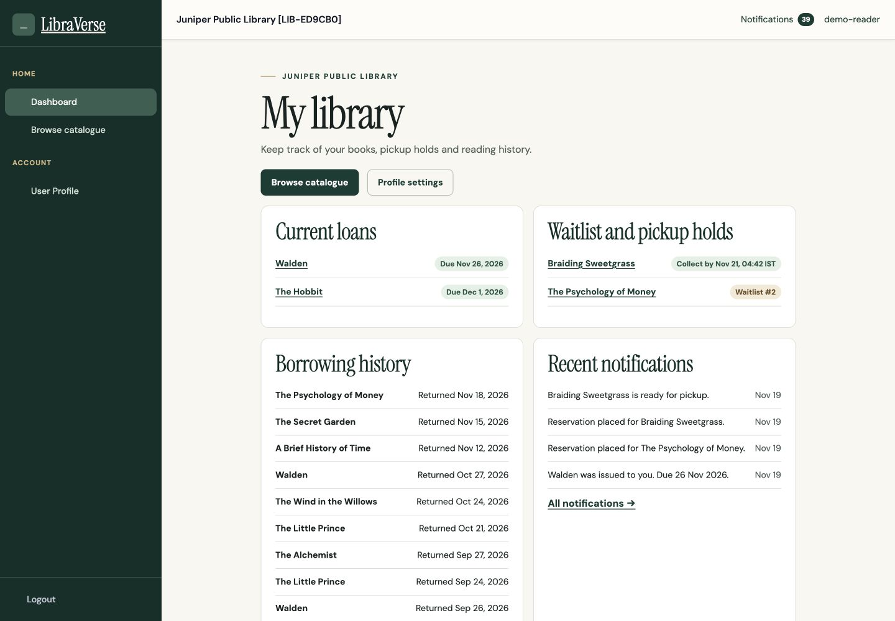
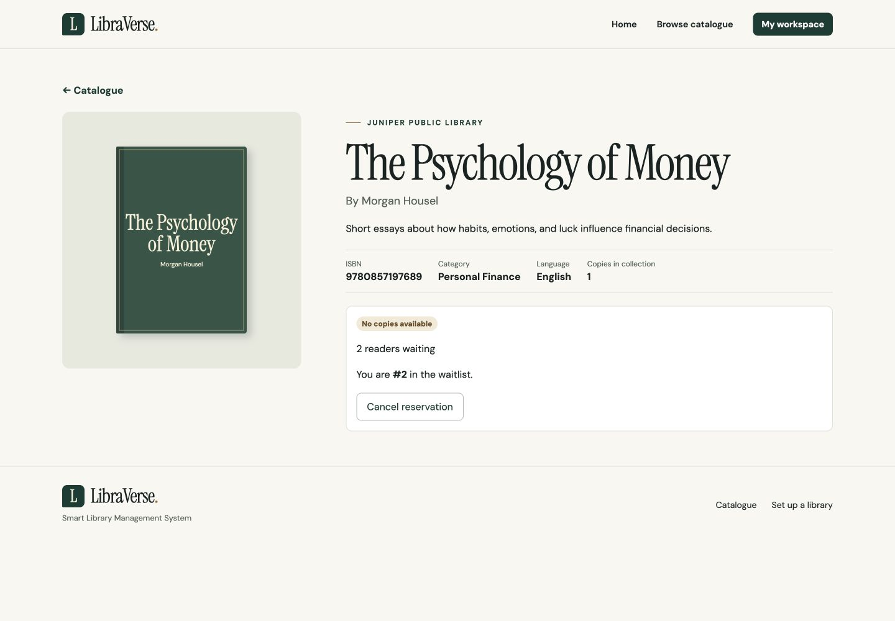
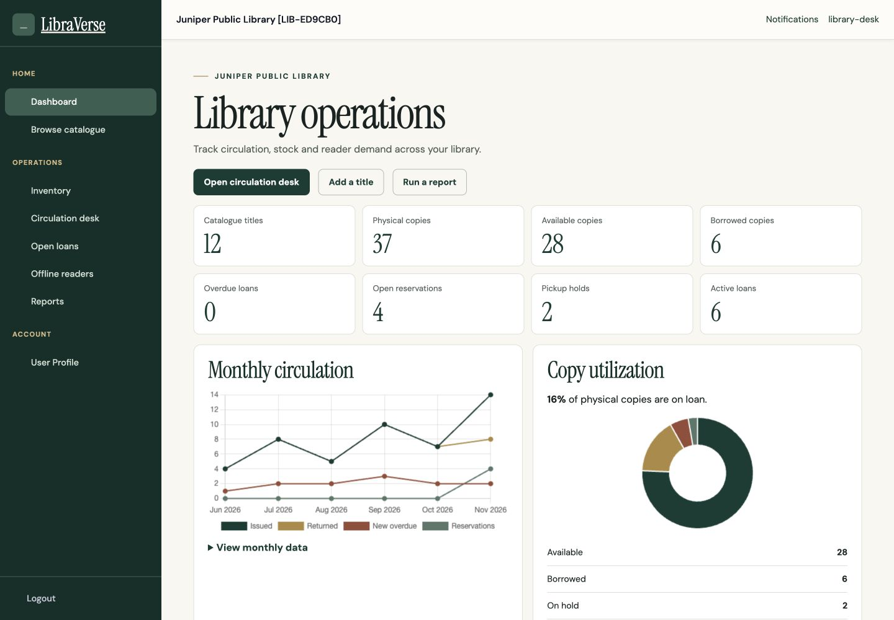
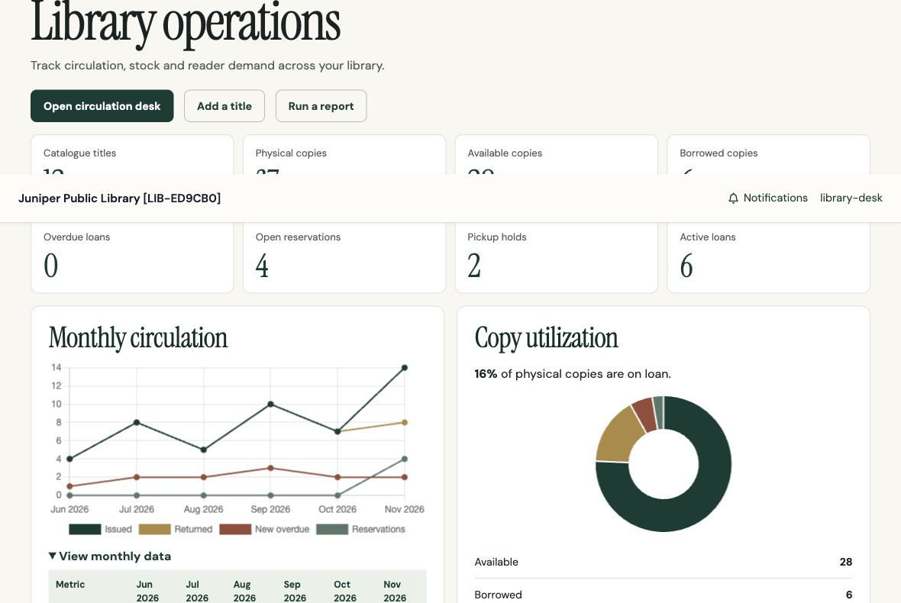
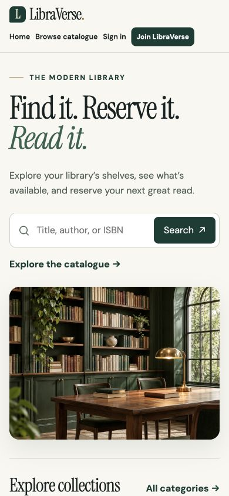
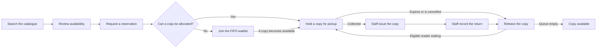

# LibraVerse

### Smart Library Management System

*Find it. Reserve it. Read it.*

[](https://www.python.org/)
[](https://www.djangoproject.com/)
[](https://www.postgresql.org/)

[](LICENSE)

LibraVerse brings a searchable public catalogue, a reader workspace, and a staff circulation desk into one application. Readers can see which books are available, join a waitlist, and collect a specific copy when it is ready. Staff can track inventory, issue and return books, and report on circulation across each library.

## Screenshots



The gallery shows the running Django application with a fictional library and synthetic circulation records.

| Catalogue | Book details |
| --- | --- |
|  |  |
| Search by title, author, or ISBN and refine the results without a full page reload. | Review a title’s description, related books, and current availability. |

| Reader workspace | Reservations |
| --- | --- |
|  |  |
| Track due dates, pickup deadlines, and recent activity from one place. | See your waitlist position and cancel a reservation from the title page. |

| Librarian workspace | Analytics |
| --- | --- |
|  |  |
| See availability, overdue loans, open reservations, and pickup holds. | Compare monthly activity and stock utilization. |

<details>
<summary>Mobile homepage</summary>



</details>

## Features

| Area | What LibraVerse supports |
| --- | --- |
| Book discovery | Debounced search suggestions, live catalogue filters, sorting, pagination, quick views, and related titles. |
| Book Match | Describe what you want to read and get up to three catalogue recommendations, with the matched terms and current availability. Members can reserve directly from the results. |
| Inventory | Titles, authors, categories, and individual copies with stable IDs and lifecycle states. Upload a cover for title verification or leave it blank for an automatically generated cover. |
| Reader accounts | Registration, login, private or public library membership, borrowing history, due dates, and in-app notifications. |
| Circulation | QR-assisted lookup, printable copy labels, manual copy-ID entry, copy-level checkout, returns, and activity history. |
| Reservations | First-in, first-out waitlists, one active reservation per title and member, automatic allocation, pickup deadlines, and cancellation. |
| Staff tools | Import titles and offline readers from CSV, manage loans through the circulation desk, and export filtered reports as CSV or PDF. |

### Library roles

| Role | What they can do |
| --- | --- |
| Visitor | Browse and search public catalogues. |
| Reader | Reserve books and view loans, pickup deadlines, and notifications in their library. |
| Librarian | Manage titles, physical copies, offline readers, loans, and reports in their library. |
| Owner | Do librarian work, manage memberships and staff roles, and control public catalogue access. |

## How it works



The circulation service locks inventory and updates the copy record, loan, hold, and stock count within a transaction. When a copy becomes available, the next eligible reader receives an in-app pickup notification. A scheduler must invoke the circulation command to process time-based hold expiry and due-date reminders while the desk is idle.

## Stack and architecture

| Layer | Technology |
| --- | --- |
| Server | Python 3.12+, Django 5.2, Django ORM |
| Templates and interaction | Django templates, custom CSS, vanilla JavaScript, Fetch API |
| Database | SQLite for local development, PostgreSQL supported for multi-user deployments |
| Authentication | Django sessions and password validation, django-allauth for optional Google sign-in |
| Cover verification | Pillow and EasyOCR with English models |
| Charts and reporting | Chart.js, ReportLab, Python CSV tooling |
| Server and assets | Gunicorn, WhiteNoise, optional Cloudinary for uploads |

LibraVerse uses Django’s model–view–template architecture. Models represent titles, individual copies, loans, reservations, holds, and notifications. Views enforce membership and permissions, then render templates or return JSON to the search and reservation controls. Inventory, circulation, and reporting share the same database records. Django renders the public and authenticated pages.

```text
LibraVerse/
├── apps/
│   ├── accounts/         # Registration, sign-in, and account setup
│   ├── books/            # Catalogue, inventory, circulation, and reports
│   ├── core/             # Library context, permissions, and profiles
│   ├── members/          # Membership and staff role management
│   └── students/         # Offline reader records and imports
├── docs/
│   └── screenshots/     # Captures of the running application
├── librarymanagement/
│   ├── library/
│   │   ├── migrations/  # Existing migration history
│   │   └── templates/   # Public pages and role-based workspaces
│   ├── settings.py
│   └── wsgi.py
├── static/              # CSS, JavaScript, and application assets
├── manage.py
└── requirements.txt
```

## Local setup

Install Git and Python 3.12 or later. These commands use SQLite, which creates a local database when migrations run.

**macOS and Linux**

```bash
git clone https://github.com/shivaa-rana/LibraVerse.git
cd LibraVerse
python3 -m venv .venv
source .venv/bin/activate
python -m pip install -r requirements.txt
cp .env.example .env
```

**Windows PowerShell**

```powershell
git clone https://github.com/shivaa-rana/LibraVerse.git
Set-Location LibraVerse
py -3.12 -m venv .venv
.\.venv\Scripts\python.exe -m pip install -r requirements.txt
Copy-Item .env.example .env
```

Generate a unique Django secret in `.env`, apply migrations, and start the development server. On Windows, use `.\.venv\Scripts\python.exe` in place of `python`.

```bash
python -c "from pathlib import Path; from django.core.management.utils import get_random_secret_key; p=Path('.env'); p.write_text(p.read_text().replace('replace-with-a-generated-secret', get_random_secret_key(), 1))"
python manage.py migrate
python manage.py runserver
```

Open the local site at `http://127.0.0.1:8000/`. The catalogue starts empty. Add titles and enable public visibility to show them on the homepage. Select **Set up a library** to create a library owner account. If you also need access to Django’s separate global admin at `/admin/`, run `python manage.py createsuperuser`.

### Book covers

In **Inventory → Add a title**, leave **Book cover** blank to display a generated cover with the title and author. This also works when an existing cover is removed. The generated design appears on catalogue cards and book detail pages.

To upload a cover, choose a JPEG, PNG, or WebP file up to 5 MB and 20 megapixels. LibraVerse reads the image locally and checks for the full entered title in the detected text. If the title cannot be found, use a clear photo of the front cover with the title visible.

Install the English OCR models on the machine running Django before using cover uploads.

```bash
python -c "from easyocr import Reader; Reader(['en'], gpu=False)"
```

Run this during server provisioning and make the model cache readable by the Django process. If provisioning and serving run as different users, set `EASYOCR_MODULE_PATH` to the same cache directory in both environments.

### First circulation workflow

1. In the owner workspace, use **Add a title** to enter its details and initial copy count.
2. To allow public browsing and reader self-registration, enable the public catalogue under **Reader access**. For a private library, invite readers under **Members**.
3. Sign in as a member, find a title, and select **Reserve for pickup** or **Join waitlist**.
4. At the **Circulation desk**, scan the copy’s QR label or enter its ID. The copy page shows the borrower or assigned hold and offers the appropriate issue or return action.
5. Open **Reports** to export the same filtered records you see on screen as CSV or PDF.

### CSV imports

In **Inventory → Import titles** or **Offline readers**, use the sample CSV as a starting point, upload a UTF-8 CSV with a header row, and map the columns before confirming. Title imports require a name, author, and quantity. Offline reader imports require a name and enrollment number. Reader gender may be left blank. A row with a field that exceeds its length limit is reported and skipped while valid rows are imported.

### Configuration

Use [`.env.example`](.env.example) for the complete template.

| Setting | Purpose |
| --- | --- |
| `SECRET_KEY`, `DEBUG` | Django secret and development mode. Set `DEBUG=False` for a public deployment. |
| `DATABASE_URL` | PostgreSQL connection URL. Leaving it unset uses local SQLite. |
| `ALLOWED_HOSTS`, `CSRF_TRUSTED_ORIGINS` | Explicit public hostnames and trusted origins. |
| `PUBLIC_BASE_URL`, `TIME_ZONE` | HTTPS base URL for QR labels and invitation links, plus your library’s operating time zone. |
| `LIBRAVERSE_LOAN_DAYS`, `LIBRAVERSE_HOLD_HOURS`, `LIBRAVERSE_REMINDER_DAYS` | Loan duration, pickup deadline, and reminder lead time. |
| `CLOUDINARY_*`, `GOOGLE_CLIENT_*`, `EMAIL_*` | Optional durable media, Google sign-in, and SMTP invitation delivery. Circulation notifications appear in the app. |

## Testing

```bash
python manage.py check
python manage.py makemigrations --check --dry-run
python manage.py test apps
```

The suite covers reservations, cover validation, generated covers, CSV imports, and staff workflows. The concurrent checkout test requires row locking and is skipped on SQLite. Use a PostgreSQL test connection with permission to create a disposable test database to run it.

Browser checks used a separate SQLite database, synthetic reader and staff accounts, and desktop and mobile viewports. The project uses real database queries for all counts and charts shown in the screenshots.

## Deployment

Run the Django WSGI application behind HTTPS with PostgreSQL and durable media storage. The repository includes a Gunicorn `Procfile`, a static collection script, and a legacy Vercel Python scaffold. The commands below cover a conventional WSGI deployment.

With production environment variables set, a conventional WSGI release uses:

```bash
python manage.py check --deploy
python manage.py migrate --noinput
python manage.py collectstatic --noinput
gunicorn --bind 0.0.0.0:8000 librarymanagement.wsgi:application
```

Take a backup and rehearse existing database upgrades before applying migrations. Serve collected assets through WhiteNoise, and configure Cloudinary or another durable storage backend for user uploads. Schedule `python manage.py process_circulation` at a suitable interval, such as every five minutes, to process expired holds and generate reminders.

## Security

- Visitors see catalogues that library owners have made public. Librarian and owner actions are scoped to the active library. Django administrators have separate global access.
- Django protects forms with CSRF checks and uses secure cookies with `DEBUG=False`. Configure a trusted HTTPS proxy to overwrite the forwarded scheme header before enabling `TRUST_PROXY_SSL_HEADER`.
- Keep secrets in environment variables or deployment secret stores. Keep local databases, uploaded personal files, and environment files outside version control.
- QR labels contain a stable copy identifier and URL. Staff authorization is checked when opening protected circulation information or taking an action.
- CSV fields are escaped where they could be interpreted as formulas. PDF and CSV exports use the same filters as the reports screen.

## Future enhancements

Potential next steps include branch-aware inventory, configurable loan policies by reader type, richer accessibility checks, and full-text search for larger catalogues.

## License

LibraVerse is distributed under the [MIT License](LICENSE). See the separate notices for [Chart.js](static/vendor/chartjs/LICENSE.md) and its bundled [color utility](static/vendor/chartjs/color-LICENSE.md).
